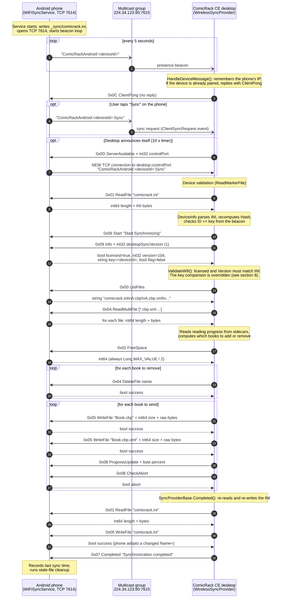

# How WiFi Sync Works

> Assembled by Claude Opus 5.5 from the current source code of this repository and the ComicRack CE desktop sync provider (`ComicRack.Engine/Sync/WirelessSyncProvider.cs`, `DeviceInfo.cs`, `SyncProviderBase.cs`). Where older project notes disagreed with the code, the code was treated as authoritative.

This document explains how the Android app synchronizes comics and reading progress with the ComicRack CE desktop application over a local network. It covers the roles of each side, the session flow, the binary wire protocol and every command on it, how device identity works, the legacy "secret" keys, and the security weaknesses of the current implementation.

---

## Contents

1. [Big picture](#1-big-picture)
2. [Components in the Android code](#2-components-in-the-android-code)
3. [Network endpoints](#3-network-endpoints)
4. [Session sequence diagram](#4-session-sequence-diagram)
5. [Wire format](#5-wire-format)
6. [Command reference](#6-command-reference)
7. [Device identity and `comicrack.ini`](#7-device-identity-and-comicrackini)
8. [The "secret" keys](#8-the-secret-keys)
9. [Storage layout on the device](#9-storage-layout-on-the-device)
10. [Reading progress round trip](#10-reading-progress-round-trip)
11. [Android runtime behavior](#11-android-runtime-behavior)
12. [Security issues](#12-security-issues)
13. [Known bugs and gaps](#13-known-bugs-and-gaps)
14. [Testing and troubleshooting](#14-testing-and-troubleshooting)

---

## 1. Big picture

The roles are the opposite of what most people expect:

| Side | Role | What it does |
|------|------|--------------|
| **Android phone** | **Server** (passive) | Advertises itself over UDP multicast, listens on TCP **7614**, and answers commands. It never decides what to sync. |
| **ComicRack CE desktop** | **Client** (active) | Discovers the phone, connects to it, validates it, decides which books to send or remove, writes files, and reads back reading progress. |

All sync logic (which books, which lists, conflict handling) lives in the desktop. The phone is effectively a small remote file system with a handshake in front of it.

Each desktop operation opens a **new TCP connection** (`WirelessSyncProvider.Communicate`), sends one command, reads the reply, and closes. The phone's server accepts any number of commands per connection, so it works either way.

The desktop's limits come from `EngineConfiguration`: 2.5 s to connect, 5 s send and receive timeouts, and 1 retry. A phone that takes longer than 5 s to answer one command (for example, reading a large file through SAF) makes that desktop operation fail.

---

## 2. Components in the Android code

All paths are relative to `ComicRackCE/app/src/main/kotlin/com/comicrack/`.

| Class | File | Responsibility |
|-------|------|----------------|
| `WiFiSyncService` | `wifi/service/WiFiSyncService.kt` | Foreground service. Resolves the library folder, builds the device identity, writes `comicrack.ini`, starts the TCP server and the beacon loop. |
| `SyncServer` | `wifi/server/SyncServer.kt` | `ServerSocket` on 7614. Accept loop, one coroutine per connection, command loop, and the outbound "beacon" connection for `ServerAvailable`. |
| `Command` | `wifi/protocol/Command.kt` | Sealed class of the 14 commands and the parser (`parseCommand`). |
| `CommandHandler` | `wifi/protocol/CommandHandler.kt` | Executes each command and writes the reply. |
| `ProtocolCodec` | `wifi/protocol/ProtocolCodec.kt` | Big-endian reading and writing of bytes, ints, longs, booleans and length-prefixed strings. |
| `BroadcastManager`, `BroadcastUtils`, `BroadcastConfig` | `wifi/broadcast/` | UDP multicast presence beacons, the `:Sync` request beacon, and a best-effort multicast listener. |
| `SyncIdentity` | `wifi/SyncIdentity.kt` | Device ID, `comicrack.ini` content, hash, version and edition constants, legacy key constant. |
| `SyncFileManager` | `wifi/file/SyncFileManager.kt` | Storage Access Framework (SAF) file operations inside `<library>/_sync/`, plus stale-file cleanup. |
| `SyncMetadataService` | `wifi/metadata/SyncMetadataService.kt` | Writes reading progress into `.cbp.xml` sidecars so the desktop can pick it up. |
| `SyncCheckWorker` | `wifi/worker/SyncCheckWorker.kt` | Periodic WorkManager job that starts the service when the phone is on the home WiFi. |
| `NetworkMonitor` | `wifi/network/NetworkMonitor.kt` | WiFi state and home SSID detection. |

---

## 3. Network endpoints

| Endpoint | Protocol | Owner | Purpose |
|----------|----------|-------|---------|
| `224.34.123.90:7615` | UDP multicast | Phone sends, desktop listens | Presence beacons and sync requests. Multicast TTL is 4. |
| `<phone>:7614` | TCP | Phone listens | All 14 sync commands. |
| `<desktop>:7620+` | TCP | Desktop listens | "Control port". The phone connects here once, in response to `ServerAvailable`, to send its beacon. The desktop starts at 7620 and increments if the port is taken. |

---

## 4. Session sequence diagram



The exact order of the inventory and transfer commands is decided by the desktop and can vary between versions; the diagram shows the typical flow. Every desktop arrow is its own short TCP connection.

---

## 5. Wire format

Everything on TCP 7614 is binary and **big-endian** (network byte order).

| Type | Encoding |
|------|----------|
| Opcode | 1 byte |
| `bool` | 1 byte, `0x00` = false, anything else = true (the phone writes `0x01`) |
| `int32` | 4 bytes, signed |
| `int64` | 8 bytes, signed |
| `string` | `int32` byte length, then that many UTF-8 bytes. Length 0 is the empty string; a negative length is a protocol error. |
| File payload | `int64` length, then exactly that many raw bytes, with no terminator |

Beacons (UDP and the control-port connection) are **plain UTF-8 text** with no length prefix: `ComicRackAndroid:<deviceId>` or `ComicRackAndroid:<deviceId>:Sync`. The desktop only checks that the first `:`-separated field starts with `ComicRack`.

---

## 6. Command reference

All commands are sent by the desktop to the phone. "Reply" is what the phone writes back on the same connection.

| Opcode | Name | Request payload (after opcode) | Reply | Phone behavior |
|:------:|------|--------------------------------|-------|----------------|
| `0x00` | `ListFiles` | none | `string`: file names joined by `\n` | Lists `<library>/_sync/`, keeping only regular files ending in `.cbp`, `.xml`, `.ini` or `.cbl`. Empty string on error. |
| `0x01` | `ReadFile` | `string` name | `int64` length + bytes | Reads the whole file into memory and sends it. Missing, invalid name or error: length `0` and no bytes. |
| `0x02` | `FreeSpace` | none | `int64` bytes | Always returns `Long.MAX_VALUE / 2`, because SAF cannot report free space reliably. |
| `0x03` | `FileExists` | `string` name | `bool` | `true` if the file exists in `_sync/`. |
| `0x04` | `DeleteFile` | `string` name | `bool` | Deletes the file. Returns `true` even if it did not exist. |
| `0x05` | `WriteFile` | `string` name, `int64` size, then `size` raw bytes | `bool` | Deletes any existing file, then writes the new one. `comicrack.ini` and `*.xml` are buffered in memory first (the INI's `Name=` is copied into app settings; XML read-status fields are logged). Other files are streamed. Invalid names: bytes are consumed and discarded, reply `false`. |
| `0x06` | `Start` | `string` message | none | Resets the progress tracker. |
| `0x07` | `Completed` | `string` message | none | Marks progress complete and ends the command loop for that connection. |
| `0x08` | `ProgressUpdate` | 1 byte percent | none | Updates the progress shown in the notification. |
| `0x09` | `Info` | `int32` desktop sync version | `bool` licensed, `int32` version, `string` key, `bool` flag | Replies `true`, `104`, the device ID, `false`. The desktop's version (currently `1`) is only logged. |
| `0x0A` | `ReadMultiFile` | `int32` count, then `count` × `string` name | for each name: `int64` length + bytes | Same as `ReadFile` for each name, flushed after each file. Missing or invalid names get length `0`. |
| `0x0B` | `CheckAbort` | none | `bool` | Returns the abort flag. In the current code this is always `false` (see section 13). |
| `0x0C` | `ClientPong` | none | none | Keep-alive from the desktop for a paired device. Only logged. |
| `0x0D` | `ServerAvailable` | `int32` control port | none on this connection | Opens a **new** TCP connection to the sender's IP at the given port and writes `ComicRackAndroid:<deviceId>:Sync` (5 s connect and socket timeouts). |

An unknown opcode raises `ProtocolException` and closes the connection.

---

## 7. Device identity and `comicrack.ini`

### Device ID

```
serial   = Settings.Secure.ANDROID_ID      (or "unknown")
deviceId = SHA1(Build.MODEL + Build.MANUFACTURER + serial), "trimZeros" hex
```

"trimZeros" hex formats each byte with `%x` instead of `%02x`, so a byte `0x0a` becomes `a`. This matches the desktop's `ToHexString(trimZeros: true)` and means IDs are often shorter than 40 characters. The ID is sent in lowercase in beacons and as the `Info` key.

### `comicrack.ini`

The file lives in `<library>/_sync/comicrack.ini`. Despite the name, it uses Java properties format, not INI sections:

```properties
#ComicRack Device Information
#Wed Oct 28 10:30:45 PDT 2026
ID=<deviceId>
Name=<device name>
Model=<Build.MODEL>
Manufacturer=<Build.MANUFACTURER>
Serial=<ANDROID_ID>
Edition=Android Full
Version=104
Screen=<widthPx>,<heightPx>,<xdpi>,<ydpi>
Hash=<SHA1(Model + Manufacturer + Serial + Edition + Version), trimZeros hex>
Capabilities=WEBP
```

- **When it is written:** every time the service starts, `ensureIniPhysical` generates the expected content. If the file is missing, or any of `ID`, `Hash`, `Name`, `Version` or `Edition` differs, the file is rewritten.
- **Device name:** chosen from the "device name source" setting (system device name, Bluetooth name, model, or a custom name). If the desktop writes back an INI with a different `Name=`, the phone stores that as its custom name.

### What the desktop checks

`DeviceInfo` (desktop) throws `InvalidDataException`, and the device is ignored, unless:

- `Model`, `Serial` and `ID` are non-empty;
- `Screen` has a non-zero width and height and DPI values above 0.1;
- `Hash` equals its own `SHA1(Model + Manufacturer + Serial + Edition + Version)` in trimZeros hex.

`SyncProviderBase.ReadMarkerFile` then requires the INI's `ID` to equal the key from the beacon. `ValidateWifi` requires `licensed == true` and the `Info` version to equal the INI `Version` (both `104`).

---

## 8. The "secret" keys

The desktop source contains two hard-coded strings that were meant to prove a phone was running the genuine, paid ComicRack Android app:

| Desktop constant | What it actually is |
|------------------|---------------------|
| `AndroidKey` | The hex-encoded DER X.509 **signing certificate** of the original cYo Soft Android app (subject `O=cYo Soft`, valid 2011-09-22 to 2036-09-15). |
| `AndroidDebugKey` | The hex-encoded certificate of a standard Android **debug** signing key (`C=US, O=Android, CN=Android Debug`). |

The original app read its own APK signature at runtime and sent it as the `key` in the `Info` reply.

Important points:

1. **These are not secrets.** A signing certificate is public: it is embedded in every copy of the APK and can be extracted with `apksigner verify --print-certs` or `keytool -printcert -jarfile`. Copying it proves nothing about who you are.
2. **ComicRack CE no longer enforces the check.** In `WirelessSyncProvider.ValidateWifi` the key comparison is immediately followed by `flag = true;`, which overrides its result. This was a deliberate ComicRack CE change (commit `2d9f92e`, 2022-01-25, "Bypass Android Key Validation (For cracked devices)"), not a decompiler artifact. Only `licensed` and the version match still matter.
3. **This app does not send either key.** The `Info` reply carries the device ID (section 7). That only works because of point 2. A desktop build that really enforced the comparison would reject this app with "Invalid device".
4. **The key is still in this codebase but unused.** `SyncIdentity.LEGACY_ANDROID_KEY` and `AppPreferencesRepository.getOrCreateDeviceKey()` both hold the `AndroidKey` certificate, but no sync code path calls them. To talk to a strict desktop, `CommandHandler.handleInfo` would have to send `LEGACY_ANDROID_KEY` instead of `deviceKey`.

There is no shared secret, password, token or encryption anywhere in the protocol.

---

## 9. Storage layout on the device

The phone serves a single folder: **`<library root>/_sync/`**, where the library root is the SAF tree URI chosen in the app's library settings. The service creates the folder if it is missing.

| File | Written by | Purpose |
|------|-----------|---------|
| `comicrack.ini` | Phone (startup) and desktop (end of sync) | Device identity (section 7). |
| `*.cbp` | Desktop | The comic itself. `.cbp` is ComicRack's portable format: the book as the desktop exports it, optimized for the device. |
| `*.cbp.xml` | Desktop, then phone | Sidecar metadata for the matching `.cbp`, including reading progress. |

Rules enforced by the phone:

- Names containing `..`, `/` or `\`, or that are blank, are rejected, so nothing can be written outside `_sync/` or into subfolders.
- Writes are delete-then-create, because SAF has no atomic overwrite.
- **Stale-file cleanup** runs when the service starts and after each completed sync. It deletes files older than 10 minutes that are either a `.cbp` without a `.cbp.xml`, or a SAF collision copy such as `Book (1).cbp.xml`.

---

## 10. Reading progress round trip

1. The desktop sends `Book.cbp` and `Book.cbp.xml`.
2. When you read a `.cbp` book on the phone, `SyncMetadataService.updateSyncReadStatus` (called from the reader and library view models) edits `_sync/Book.cbp.xml`:
   - sets `<Opened>`, increments `<OpenCount>`, and sets `<CurrentPage>` and `<LastPageRead>`;
   - sets `<ComicInfoIsDirty>true</ComicInfoIsDirty>`;
   - ensures `<ExtraSyncInformation><ReadingStateChanged>true</ReadingStateChanged></ExtraSyncInformation>`.
3. On the next sync the desktop reads the sidecars with `ReadMultiFile`, sees `ReadingStateChanged`, and updates the book in its own library.
4. The desktop writes back fresh sidecars. The phone logs the incoming `LastPageRead`, `PageCount` and computed read percentage (95% or more counts as read) for debugging.

Only books inside `_sync/` take part. Comics the phone found elsewhere in the library are never reported to the desktop.

---

## 11. Android runtime behavior

### How the service starts

| Trigger | Path |
|---------|------|
| Settings screen | Enabling WiFi sync starts `WiFiSyncService` with `ACTION_START_SYNC`. |
| Background | `SyncCheckWorker` runs every 15 minutes (5 minute flex) on unmetered networks. It starts the service only if sync is enabled, a home SSID is configured, the phone is connected to that SSID, and a sync folder is set. |
| "Sync now" | `ACTION_SEND_SYNC_REQUEST` starts the service if needed, waits 1 second, then multicasts the `:Sync` beacon. |
| Debug | `adb shell am broadcast -a com.comicrack.viewer.DEBUG_START_SYNC -n com.comicrack.viewer/com.comicrack.reader.DebugStartReceiver` |

### What the service does

- Calls `startForeground` immediately (type `dataSync`) with a "WiFi Sync" notification that has a Stop action.
- Re-checks that sync is enabled and that a home SSID is configured. It does **not** re-check that the phone is currently on that SSID; only the worker does.
- Resolves the library, builds the identity, writes the INI, runs cleanup, and starts the TCP server and beacon loop in parallel.
- Runs until stopped (`START_STICKY`). After each completed session it records the sync time and the desktop's IP as the "paired" desktop.

### Multicast

The phone sends a beacon every 5 seconds and also joins the group to listen. It holds the `CHANGE_WIFI_MULTICAST_STATE` permission but never acquires a `WifiManager.MulticastLock`. Many devices filter incoming multicast without a lock, so the listener is best effort. Sending still works, and the desktop only needs to receive.

---

## 12. Security issues

The protocol was designed in 2011 for a trusted home network. Nothing in it is authenticated or encrypted. Anyone who can reach the phone's IP can act as the desktop, and anyone on the LAN can see and pretend to be the phone.

| # | Issue | Impact | Where |
|---|-------|--------|-------|
| 1 | **No authentication on TCP 7614.** Any host that can reach the phone can send every command. | List, read, overwrite or delete anything in `_sync/`. Change the device name. Mark books as read or unread. | `SyncServer`, `CommandHandler` |
| 2 | **No encryption.** Everything travels in cleartext. | Anyone on the network can capture the comics being synced, the INI (model, ANDROID_ID, device name) and reading history, and can modify traffic in transit. | Whole protocol |
| 3 | **The "key" check is meaningless.** The keys are public certificates, the CE desktop ignores the comparison, and the phone sends its device ID instead. | Neither side can tell a genuine peer from an impostor. | Section 8 |
| 4 | **The phone can be impersonated to the desktop.** The device ID is multicast every 5 seconds, and the INI is readable over the protocol, so a rogue host can replay the beacon with `:Sync` and serve a copy of the INI. | The desktop would push that device's configured books to the attacker and accept fake reading progress. | Desktop trust model |
| 5 | **Memory exhaustion from length fields.** `readString` allocates whatever `int32` length is sent (up to 2 GB). `ReadMultiFile` accepts any count. `WriteFile` buffers `.ini`, `.xml` and rejected names entirely in memory using the sender's `int64` size. `ReadFile` loads whole files (including large `.cbp` books) into memory. | A single malicious packet can crash the app with `OutOfMemoryError`. Large legitimate books can also run out of memory. | `ProtocolCodec.readString`, `Command.parseCommand`, `CommandHandler` |
| 6 | **Untrusted files become comics.** Anything written as `.cbp` is later opened by the app's archive and image decoders. | Malformed archives or images become attack surface for the reader. | `WriteFile`, archive providers |
| 7 | **Exported components without permissions.** `WiFiSyncService` and `DebugStartReceiver` are `exported="true"` with no permission, and the debug receiver ships in release builds. | Any app on the phone can start or stop sync, or trigger a sync request, and so cause the phone to open port 7614. | `AndroidManifest.xml` |
| 8 | **Device tracking.** The device ID is a stable SHA-1 of model, manufacturer and ANDROID_ID, broadcast every 5 seconds whenever the service runs, and the INI exposes ANDROID_ID itself. | Anyone on the same network can recognize the phone across sessions. | `SyncIdentity`, `BroadcastManager` |
| 9 | **Home network check is by SSID name only, and only in the worker.** Anyone can create a WiFi network with the same name. Manual or debug starts skip the check. | The phone can end up serving port 7614 on an untrusted network. | `SyncCheckWorker`, `WiFiSyncService.startSync` |
| 10 | **Outbound connection on request.** `ServerAvailable` makes the phone connect to the sender's IP on any port the sender chooses. | Minor: the target is always the sender itself, but it can be used to make the phone send traffic on demand. | `SyncServer.sendBeaconToDesktop` |
| 11 | **Free space is fake.** `FreeSpace` always reports about 4.6 exabytes. | The desktop never holds back, so a large sync can fill the phone's storage. | `SyncFileManager.getFreeSpace` |
| 12 | **Verbose logging.** Debug builds log every byte read and written plus identity details (ANDROID_ID, device name). | Logs contain identifiers. Only debug builds log protocol bytes. | `ProtocolCodec`, `WiFiSyncService` |

### Practical mitigations

These do not require changing the desktop:

- Only enable WiFi sync on a network you trust, and stop the service when not syncing.
- Bound every length field: reject strings over a few KB, `ReadMultiFile` counts over a few thousand, and in-memory buffers over a few MB. Stream `ReadFile` instead of loading whole files.
- Remove `exported="true"` from `WiFiSyncService` (the app starts it itself) and compile `DebugStartReceiver` only into debug builds.
- Acquire a `MulticastLock` only while the service runs.
- Re-check the current SSID in the service, not just in the worker.
- Report real free space for the library volume where possible.

Real authentication or encryption would need cooperation from the desktop (for example a pairing code and TLS), because the legacy protocol has no place for either.

---

## 13. Known bugs and gaps

- **Abort never works.** `SyncServer.requestAbort()` only logs. `CommandHandler` keeps its own `isAborted` flag per connection, and nothing sets it, so `CheckAbort` always replies `false`.
- **The `Command.Info` KDoc is backwards.** It describes the phone sending a version and reading a reply. The handler does the opposite (section 6).
- **Unused legacy key code.** `SyncIdentity.LEGACY_ANDROID_KEY` and `AppPreferencesRepository.getOrCreateDeviceKey()` are never called (section 8).
- **No multicast lock** (section 11).
- **Two filename validators.** `CommandHandler.isValidFilename` and `SyncFileManager.isValidFilename` differ slightly. The stricter `SyncFileManager` check is the one that actually protects storage.
- **Older notes are out of date.** Earlier project notes describe a `ComicRack:<key>` beacon, version 100, a `.sync` folder, and a 10-second beacon. The current code uses `ComicRackAndroid:<id>`, version 104, `_sync`, and 5 seconds.

---

## 14. Testing and troubleshooting

### Logs

Filter logcat by these tags:

```bash
adb logcat -s WiFiSync:* SyncServer:* CommandHandler:* ProtocolCodec:* BroadcastManager:* WiFiSyncService:*
```

`CommandHandler` logs every command as `PROTOCOL [xx] ← Name` and every reply as `PROTOCOL [xx] → ...`. In debug builds `ProtocolCodec` also logs each field it reads and writes.

### Emulator

Multicast does not cross the emulator's virtual network, and the desktop cannot reach the emulator's IP directly.

- `tools/emulator_sync.py` forwards TCP 7614 from the host into the emulator (`adb forward tcp:7614 tcp:7614`) and sends beacons on the host's behalf, so the desktop discovers "the emulator" at the host's address.
- `ComicRackCE/tools/test_pairing.ps1` captures a pairing session with Wireshark (`tcp.port == 7614 || udp.port == 7615`).

### Common failures

| Symptom | Likely cause |
|---------|--------------|
| Phone never appears on the desktop | Service not running (check the notification), not on the home SSID, desktop on a different subnet, or a router or firewall blocking multicast. Windows Firewall must allow ComicRack on UDP 7615. |
| Desktop sees the phone but sync fails immediately | `comicrack.ini` is missing or invalid (bad `Hash`, zero `Screen`), or the `Version` in the INI differs from 104. Restarting the service rewrites the INI. |
| "Invalid device" from the desktop | `licensed` false or a version mismatch, or a desktop build older than the 2022 ComicRack CE change that stopped enforcing the key comparison (section 8). |
| Desktop operations time out | The phone took more than 5 s to answer one command, which can happen when SAF is slow to open or read a large file. |
| Books arrive but reading progress never returns | The book was not opened from `_sync/`, or the sidecar `.cbp.xml` is missing or has a SAF collision name such as `Book (1).cbp.xml`. |
| Duplicate files such as `Book (1).cbp` | SAF renamed a file during a write. Cleanup removes them after 10 minutes. |
